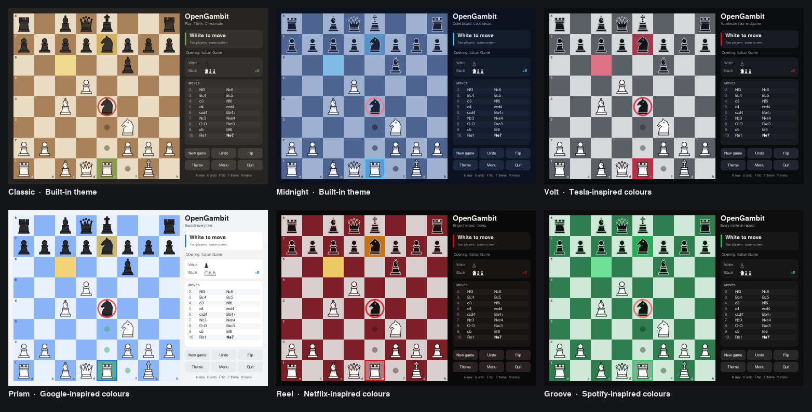
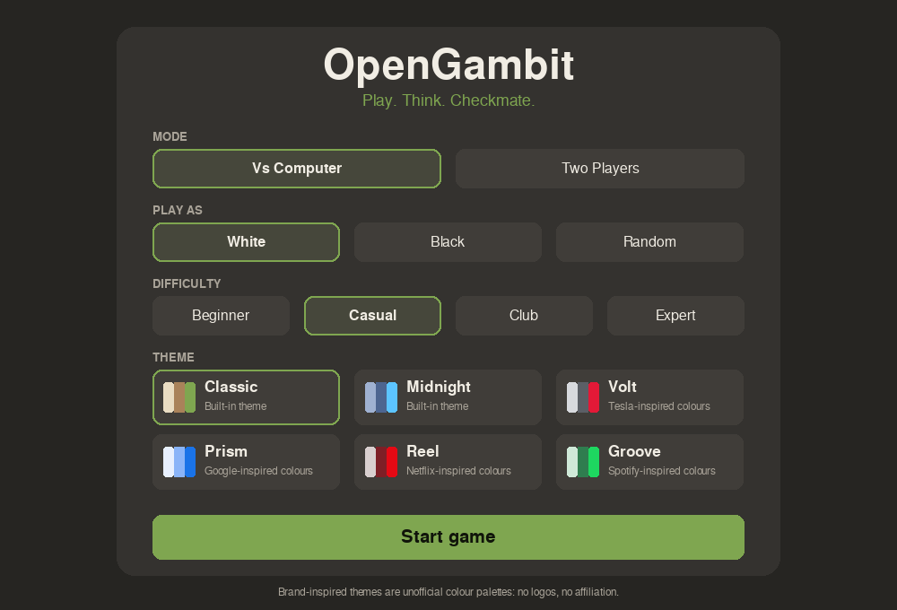
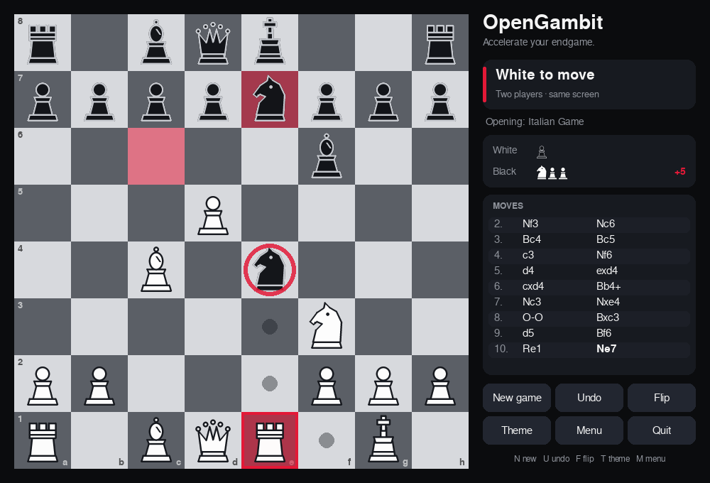
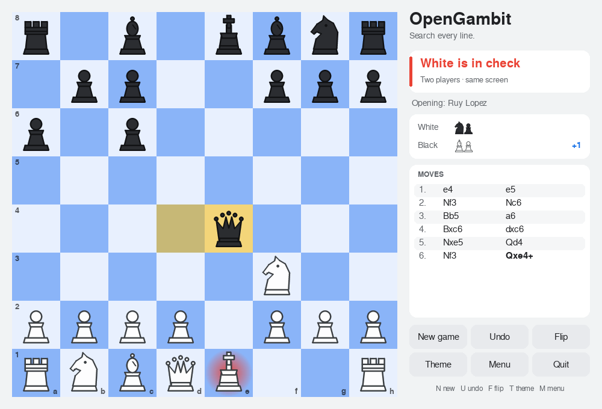
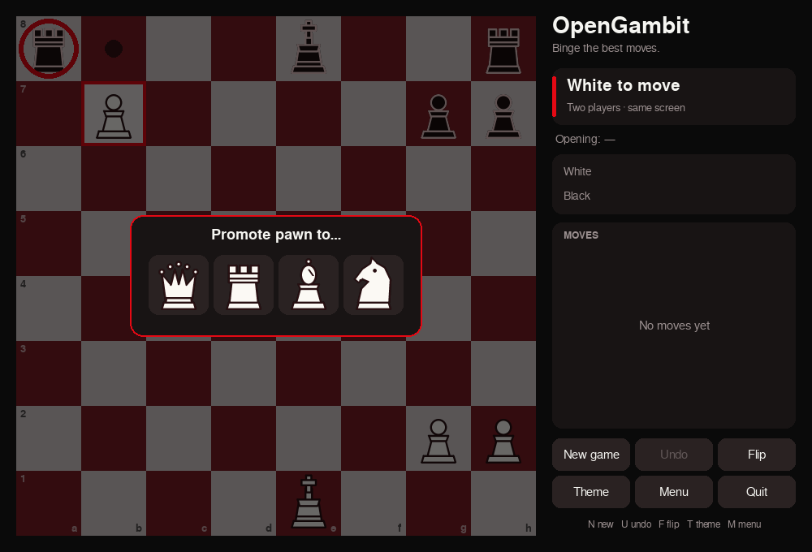
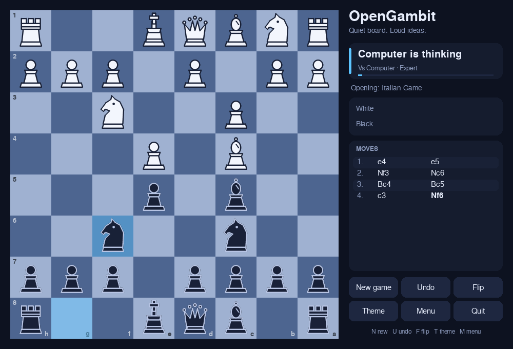
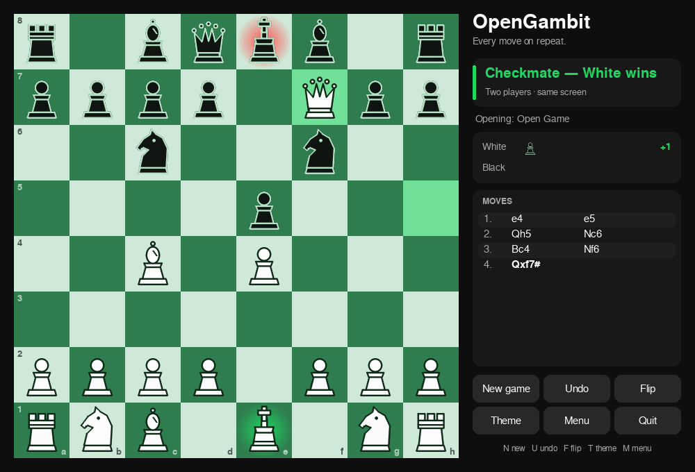

# OpenGambit

A fast, themeable desktop chess game written in Python with [pygame](https://www.pygame.org/)
Play a friend on the same screen or challenge the built-in computer opponent at four strengths



## Features

- Complete chess rules: castling, en passant, **under-promotion picker**, check / checkmate, stalemate, fifty-move rule, threefold repetition and insufficient-material draws
- Computer opponent: iterative-deepening alpha-beta search, transposition table, quiescence search, move ordering, tapered evaluation and a JSON opening book (Beginner → Expert)
- Drag-and-drop **and** click-to-move, legal-move hints, last-move highlight, animated moves
- Move list in standard algebraic notation, captured pieces with material count, opening name
- Undo, flip board, new game, keyboard shortcuts
- **Six switchable themes** defined as plain JSON, so re-branding takes no code
- 100 % original artwork: pieces are drawn procedurally, so there are no image files to license
- No personal data, no network access, no telemetry

## Quick start

```bash
pip install -r requirements.txt          # just pygame
python -m opengambit                     # opens the menu
python -m opengambit --theme volt --level club --color black --play
python -m opengambit --list-themes
```

| Key | Action | Key | Action |
|-----|--------|-----|--------|
| `N` | New game | `F` | Flip board |
| `U` | Undo | `T` | Next theme |
| `M` | Menu | `Esc` | Cancel / hide banner |

## Screenshots

| Menu | Mid-game with move hints |
|---|---|
|  |  |
| **Check** | **Promotion picker** |
|  |  |
| **Computer thinking (playing Black)** | **Checkmate** |
|  |  |

## Themes and re-branding

Themes live in [`opengambit/data/themes.json`](opengambit/data/themes.json). Each is a name, a tagline and a palette. Copy an entry, change the colours, restart: it appears in the menu

| Theme | Look |
|---|---|
| Classic, Midnight | Neutral built-ins |
| Volt | Tesla-inspired palette (graphite, white, signal red) |
| Prism | Google-inspired palette (light UI, blue / yellow / green / red accents) |
| Reel | Netflix-inspired palette (black and deep red) |
| Groove | Spotify-inspired palette (near-black and bright green) |

## Project layout

```
opengambit/
  engine.py    rules, move generation, make/unmake, SAN, FEN, game outcome   (no dependencies)
  ai.py        evaluation + search + difficulty levels                         (no dependencies)
  book.py      JSON opening book loader                                        (no dependencies)
  game.py      session state: history, captures, undo, status text             (no dependencies)
  themes.py    JSON theme loader and validation                                (no dependencies)
  pieces.py    procedural piece artwork
  ui.py        pygame front-end
  data/        themes.json, openings.json
tests/         33 unit tests incl. perft and simulated mouse input
tools/         make_screenshots.py
docs/          ANALYSIS.md, screenshots/
```

The engine, AI, book, game and theme modules never import pygame, so you can reuse them with a different front-end (web, terminal, bot...)

## Tests

```bash
python -m unittest discover -s tests -t .
```
